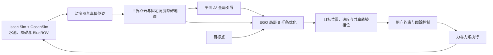
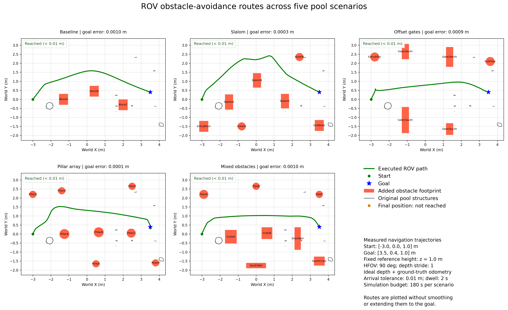

# 组会汇报：EGO 局部规划在 BlueROV 水池避障导航中的迁移与验证

汇报日期：2026 年 10 月 15 日。建议时长 8–10 分钟，其中 Demo 约 3 分钟。

本次展示当前正式版本：`baseline`、`slalom`、`gates`、`pillars`、`mixed`。修正后的 slalom 和门洞已替换原入口，演示时直接使用这些名称，无需加载额外覆盖配置。

## 1. 工作目标与当前进度（约 40 秒）

**页面内容**

- 最终目标：水下机器人的语义驱动巡检决策与导航。
- 当前阶段：先完成避障导航闭环，为后续语义任务提供运动能力。
- 已完成：Isaac Sim 与 OceanSim 部署、ROS2 EGO 工程复现、BlueROV 闭环执行、多场景测试和轨迹可视化。

**讲述稿**

> 我的毕设目标是实现水下机器人的语义驱动巡检。当前先完成其依赖的自主避障导航：把 EGO 的局部规划能力接入 Isaac Sim 和 OceanSim，让 BlueROV 根据深度观测规划、绕障并实际到达目标，同时能够看到规划轨迹如何更新。

当前验证的是固定参考高度的导航。语义任务决策、完整水动力和实际机器人接口联调尚未完成。

## 2. EGO 的核心思路（约 1 分钟）

**页面内容**


**讲述稿**

> EGO 是一种基于梯度优化的局部轨迹规划方法。它用 B 样条表示轨迹，兼顾平滑性、避障和运动约束。它的特点是无需维护完整 ESDF，而是通过碰撞轨迹与无碰撞引导路径的比较提取必要的障碍信息，并在运动中持续重规划。

“ESDF-free”仍然需要障碍地图。算法机制来自 [EGO-Planner 原论文](https://arxiv.org/abs/2008.08835)；本项目的工作是 ROV 导航适配与仿真验证，不把 EGO 原算法作为原创贡献。本机实现基于已复现的 ROS2 EGO-Planner-Swarm 工程。

## 3. 如何迁移到水下机器人（约 1 分钟）

| 环节 | 本项目的实现 |
|---|---|
| 仿真平台 | Isaac Sim 场景与物理仿真，接入 OceanSim 水下相机 |
| 机器人 | BlueROV 模型、显式船体碰撞体、闭环力与力矩执行 |
| 感知与地图 | 深度反投影为世界坐标点云，累计观测并构造固定高度障碍列 |
| 全局引导 | 在已观测膨胀地图上执行平面 A*，约束在已知水域内 |
| 局部规划 | 保留 EGO 的 B 样条优化与局部重规划 |
| 跟踪控制 | 位置反馈叠加参考速度；运动前先将前视相机朝向对准 |
| 执行协调 | 转向等待时暂停轨迹进度，规划器与轨迹服务器共享相位 |
| 可视化 | 当前规划、历史规划、实际运动轨迹与规划/跟踪状态 |

**讲述稿**

> 我迁移的是 EGO 的局部轨迹规划机制。针对 ROV 的低速运动和前向相机，需要适配地图、船体余量、跟踪器和执行时序。另外增加了基于已观测地图的平面 A* 全局引导，避免一直以穿过障碍区的直线作为参考。A* 提供引导，EGO 负责局部轨迹优化。

RViz 是 ROS 侧的可视化工具；本项目将场景、物理执行与在线轨迹展示放到 Isaac Sim 中，而不是仅替换可视化窗口。

## 4. 当前系统闭环（约 50 秒）



已知水域边界用于限制全局引导；障碍信息来自深度观测，没有直接把 USD 中的障碍位置灌入规划器。原水池碰撞网格作为双面渲染代理参与深度观测，使其结构能够被感知。

## 5. 本轮解决的主要问题（约 1 分钟）

| 问题 | 修改后的行为 |
|---|---|
| 转向停止平移时，名义轨迹继续推进，反复触发恢复 | 转向等待时冻结共享轨迹进度；地图和物理仿真继续运行 |
| 原水池细结构或船体顶部附近障碍漏检 | 双面渲染碰撞代理，覆盖船体高度并逐像素采样深度 |
| 仅用全局直线参考，容易引向障碍区 | 增加已观测地图上的平面 A* 引导，局部终点检查占用 |
| 低速时参考yaw与平移方向不一致 | 统一按实际平移方向计算朝向，与FSM暂停条件同步 |
| 软轨迹终点距真实目标仍有偏差 | 使用经过占用及运动约束检查的精确终端B样条 |
| 受阻后仍从名义位置重规划 | 根据实测跟踪偏差保持并重新规划 |
| 目标位于占用区域仍不断重试 | 显示 BLOCKED_GOAL 并保持，允许重新指定有效目标 |

**讲述稿**

> 之前 slalom 会出现转向、停车和重规划反复切换。原因之一是机器人还在转向，轨迹却已经向前推进。现在规划和执行共用进度，朝向不满足时先等待；同时补齐感知覆盖，并增加地图引导。这是规划、感知和执行的联合修正。

## 6. 统一实验条件（约 30 秒）

| 条件 | 当前设置 |
|---|---|
| 起点 / 目标 | `(-3.0, 0, 1.0)` / `(3.5, 0.4, 1.0)`，单位 m |
| 参考高度 | 世界坐标 z=1.0 m；水面 z=1.55 m |
| 速度 / 加速度上限 | 0.3 m/s / 0.3 m/s² |
| 障碍膨胀 | XY 方向 0.5 m |
| 相机 | 640×360，水平视场 90°，逐像素深度采样 |
| 感知与定位 | 理想深度、仿真真值位姿，静态障碍 |
| 动力执行 | 中性浮力近似、阻尼、姿态恢复与闭环力控制 |
| 到达判据 | 三维目标误差 <0.01 m，连续保持 2 s |
| 单场预算 | 最多 180 s 仿真时间 |

z=1.0 m 表示世界参考高度，不是水面下潜深度 1 m。当前没有验证真实水下定位、浑浊条件下的深度退化或完整推进器水动力。

## 7. 五场景结果与路径图（约 1 分钟）



| 场景 | 新增障碍数 | 最终误差(m) | 仿真用时(s) | 规划更新数 | 到达 |
|---|---:|---:|---:|---:|---|
| baseline | 3 | 0.001038 | 45.87 | 30 | 是 |
| slalom | 7 | 0.000340 | 67.07 | 44 | 是 |
| gates | 6 | 0.000875 | 114.70 | 40 | 是 |
| pillars | 8 | 0.000082 | 87.77 | 37 | 是 |
| mixed | 8 | 0.001015 | 63.80 | 40 | 是 |

表中五次运行均达到统一判据，最大接触冲量均为零。每场仅一次运行，不能把 5/5 解释为统计成功率。slalom 允许从障碍阵列外围绕行，不要求按 S 形逐个穿过间隙。

slalom 还完成延迟100秒发目标的复验：总仿真185.77 s，最终误差0.000623 m，最大接触冲量为零。

slalom 另做了延迟55秒发目标的带窗口复验：首次记录任务后约135.23 s到达，最终误差0.000014 m，最大接触冲量为零；总仿真时间191.87 s包含起始等待。

本表与路线图全部来自同一轮最终五场回归 `five_scenarios_20261015_turn_fix`；起终点、布局、速度和相机配置保持一致。后续实跑发现了旧版本的复发问题，本表已更新为本次修正后的实测，旧记录保留。

单图与矢量版本：[图片目录](figures/five_routes_20261015_turn_fix/README.md) · [图片压缩包](figures/five_routes_20261015_turn_fix_figures.zip)。

## 8. Demo 演示顺序（约 3 分钟）

建议现场运行 slalom，展示转向等待与轨迹更新；随后播放 gates 和 mixed 的实测动画。这样既能展示交互仿真，也能在有限时间内覆盖多种布局。

| 演示 | 素材 | 讲述重点 |
|---|---|---|
| slalom 现场运行 | 按下面三个终端启动 | 感知、规划、转向与实际运动构成闭环 |
| slalom 窗口验证动画 | [GIF](../logs/diagnostics/slalom_turn_fix_20261015/delay55_terminal_gui/slalom/trajectory_updates.gif) | 对照当前规划与实际运动 |
| gates 实测动画 | [GIF](../logs/suites/five_scenarios_20261015_turn_fix/gates/trajectory_updates.gif) | 门洞布局中的安全通路选择 |
| mixed 实测动画 | [GIF](../logs/suites/five_scenarios_20261015_turn_fix/mixed/trajectory_updates.gif) | 多种形状障碍的绕行 |

仿真视口颜色：青色为当前规划，橙色为最近的旧规划，绿色为实际轨迹，黄色为可选控制点。线条投影到水面上方，便于观察水平路线；显示高度不代表实际深度。

**终端一：选择场景并启动仿真**

```bash
cd /home/ache/Coding/rov_navigation
bash scripts/select_scenario.sh slalom
bash scripts/start_sim.sh
```

**终端二：启动导航**

```bash
cd /home/ache/Coding/rov_navigation
bash scripts/start_navigation.sh
```

**终端三：等待仿真就绪、点云与里程计持续发布后发送目标**

```bash
cd /home/ache/Coding/rov_navigation
bash scripts/send_goal.sh
```

切换到门洞时，先结束上述仿真和导航进程，再将第一条选择命令改为：

```bash
bash scripts/select_scenario.sh gates
```

其余可选名称是 `baseline`、`pillars`、`mixed`。每次切换都重新启动，避免沿用上一场地图缓存。

## 9. 下一步工作（约 30 秒）

1. 增加多起终点与重复试验，评估到达率、规划耗时、路径长度和跟踪误差。
2. 加入水下观测退化与定位误差，逐步验证当前理想条件之外的表现。
3. 接入实际推进器/控制接口，再逐步完善水动力。
4. 在导航能力之上实现语义任务到巡检目标点与任务序列的转换。

**结束讲述稿**

> 本阶段已经完成了从深度观测、地图、路径引导到 EGO 局部规划和 ROV 执行的仿真闭环，并完成五种布局的到达验证。接下来会先扩大导航测试，再把语义巡检任务接入这一运动执行能力。

## 可能的提问

**你的工作与 EGO 原算法的区别？**

EGO 局部轨迹优化来自已有工程。本阶段完成的是水下仿真接入、地图构造、低速 ROV 跟踪与执行时序协调、已观测地图全局引导和测试可视化，尚未主张新的 EGO 优化算法。

**为什么需要额外的 A*？**

EGO 主要负责局部轨迹优化。这里的平面 A* 在已观测地图上提供任务尺度的引导，减少全局直线穿过障碍造成的反复尝试；它与 EGO 内部用于避障约束构造的引导搜索作用不同。

**是不是已经完成语义巡检或真实水下验证？**

目前完成的是固定高度、静态障碍、理想深度与真值定位下的仿真避障导航。语义决策和真实接口联调仍是下一阶段。

## 实测来源

- [正式 gates 更名后独立复验](../logs/suites/gates_promoted_20261015/gates/run.json)

- [本批五场数据汇总](../logs/suites/five_scenarios_20261015_turn_fix/summary.json)
- [本轮修复与核验记录](slalom_turn_fix_20261015.md)
- [slalom 修复过程](slalom_execution_fix.md)
- [正式入口对应的图片与原始数据映射](figures/five_routes_20261015_turn_fix/sources.json)

历史失败记录不作为当前演示结果，原始日志保留用于追溯。
