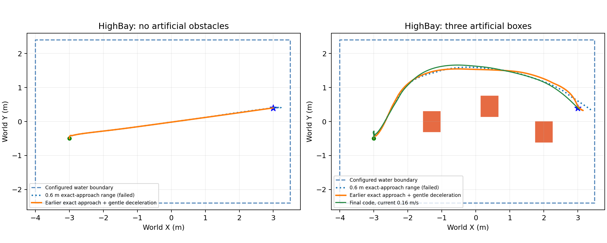
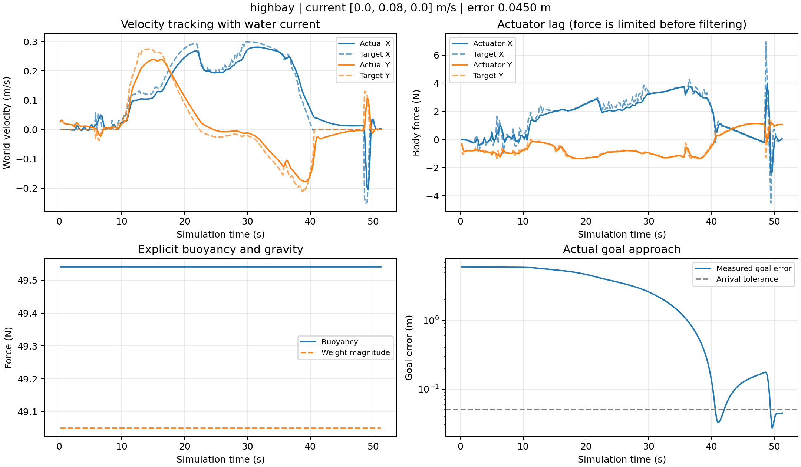
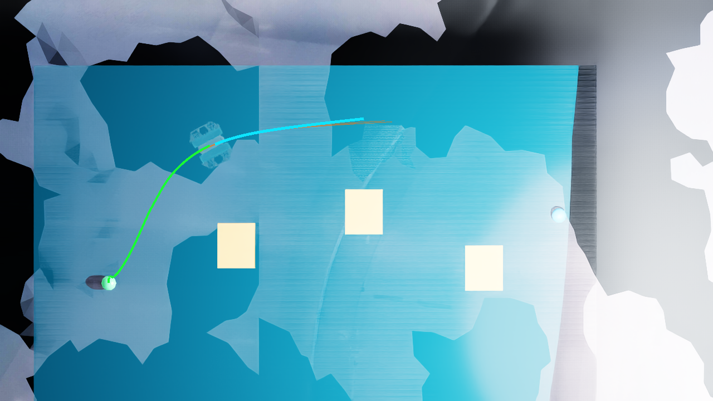

# HighBay 场景接入、导航迭代与验证（2026-10-28）

本轮直接引用 `OceanSim-Highbay/data/HighBay/HighBay.usd` 的原始视觉、纹理、灯光和三角网格碰撞体，在该扫描场景内运行带阻力、推进响应滞后、浮力和横流的导航。场景组成和水动力参数分别记录，不能以水面截图代替运行验证。

## 水体与场景来源

原始 HighBay 资产包含 325 个视觉网格、1 个碰撞网格和 6 盏灯，**本身没有水体**。本次没有把另一个坐标系下的 `Tile3_water.usda` 当作 HighBay 自带水面，而是新增 `scenes/highbay_water.usda`：一个无碰撞的平面，配合有限水域内的简化流体力模型。它不是实测 HighBay 水位、原装流体求解器或 CFD。

- 原始碰撞体：153,776 个顶点、291,648 个三角形，PhysX `approximation=none`；没有用盒子或人工池底替换它。
- 原始扫描整体只平移 `[14,9,0]` m，没有旋转或缩放；源文件不改动。
- 世界起点 `[-3,-0.5,1]`、终点 `[3,0.4,1]` m，分别对应源坐标 `[-17,-9.5,1]` 和 `[-11,-8.6,1]`。
- 配置测试水域：X 为 `[-4,3.5]`，Y 为 `[-2.4,2.4]` m；水面 Z=1.55 m、流体模型下边界 Z=-0.4 m。下边界只参与浸没率计算，不是新增池底碰撞面。矩形范围是实验选择，不代表扫描水池的测绘边界。
- `highbay_open` 不放人工障碍；`highbay` 加入三个人工测试箱，位置与尺寸在 `config/scenarios.json` 中明确列出，不能称为扫描自带设施。

静态审计核对实际组成层、纹理解析、变换、碰撞 API、水面与边界一致性，并记录依赖资产 SHA256。运行另存 `scene_evidence.json`，证明实际打开的场景包含 HighBay 图层、326 个环境网格和配置水面。原始大资产保留在外部目录，不随 Git 分发。

## 发现的问题与修改

1. 直接使用旧预览出生点可能落入扫描网格；初次试验产生约 174 N·s 接触冲量，立即判失败。调整到经过原始三角网格距离校核的起点；没有关闭碰撞来绕过问题。
2. 自由终点 rebound 样条会越过目标。一次空场测试停在目标外约 25 cm，带箱测试停在约 37 cm 外。旧的精确终点修正仅在很近时启用，过冲后又可能越出已知水域引导的允许范围，无法恢复。
3. 扩大到 0.6 m 的修正仍不充分：空场虽到达，船体转向边角最多越出配置水域约 10 cm；带箱仍超时。该版本不计为通过。
4. 先改为：目标进入 3 m 局部规划范围且可以直达时，尝试精确终点样条，保留实际初速度，逐段检查占用、速度和加速度；直达受阻则继续 rebound 绕障。找到有效精确末段后不再每 0.5 s 从低速起点重建它，避免始终无法加速；地图碰撞检查与真实跟踪偏差恢复仍保留。
5. 精确终点仍未消除执行器惯性：空场虽达到约 5.5 mm 最终误差，转向时角点仍越界约 6.5 cm，不能作为完整通过。进一步给精确末段保留跟踪余量：目标速度 0.15 m/s、加速度 0.1 m/s²；初始实际速度较高时允许从该速度平滑减速，不跳变初速度。原本 0.3 m/s 的全程速度上限与水域、目标不变。

水动力沿用上一轮模型和参数：5 kg、1% 正浮力、机体系线性/二次阻力、推进一阶响应 0.25 s、力矩响应 0.12 s；PI 控制器不读取真实水流进行抵消。新增水域/碰撞路径配置，避免 HighBay 误用旧 Platform 边界。水动力覆盖文件按参数键合并，修改横流时保留其余实验参数。

## 验证与结果

最终 HighBay 到达判据为实际位置误差小于 5 cm 并连续保持 2 s，本轮与此前文档的 1 cm 判据不同，不能直接比较成绩。结果为单次试验，不是成功率或长时间定点保持验证。

| 条件 | 横流 Y (m/s) | 仿真用时 (s) | 最终误差 (cm) | 扫描净空下界 (m) | 水域角点余量 (m) | 人工障碍净空下界 (m) |
|---|---:|---:|---:|---:|---:|---:|
| HighBay 空场 | 0.08 | 58.53 | 1.21 | 0.929 | 0.235 | 无人工障碍 |
| HighBay 三箱 | 0.08 | 51.40 | 4.50 | 0.924 | 0.019 | 0.386 |
| HighBay 三箱、双倍横流 | 0.16 | 60.97 | 4.75 | 0.924 | 0.098 | 0.397 |

三项均无接触事件，所有记录的船体角点在配置水域内；末尾 2 s 位置采样均满足 5 cm 判据，推进力与力矩无饱和，控制有限值、限幅和 PhysX 日志核验通过。三箱默认横流仅约 1.9 cm 的最小水域余量，仍然偏窄，不能据此声称边界鲁棒性已充分解决。强流不是严格比默认流更难的单调试验：路径与转向时序也发生了变化。

原 Platform `slalom` 以此前 **1 cm 内保持 2 s** 的判据回归通过：81.73 s、最终误差 1.20 mm、最大接触冲量 0，人工障碍保守净空 0.418 m。它慢于 10 月 27 日归档的那次 61.47 s，因此本轮不宣称全局速度提升，也没有重跑其余四个 Platform 场景。

默认横流空场的速度误差 RMSE 从上一版的 0.0261 降到 0.0146 m/s，路径由 6.56 m 降到 6.12 m；这是同条件单次前后对照，主要消除了明显末段过冲与转向绕行，仍需重复试验评估稳定性。

[全部四次试验核验与受测源码 SHA256](validation/highbay_20261028/verification.json) · [HighBay 静态资产审计](validation/highbay_20261028/stage_audit.json) · [失败迭代](validation/highbay_20261028/failed_iterations.json) · [原始采样、配置与几何审计](validation/highbay_20261028/README.md) · [运行图说明](figures/highbay_20261028/README.md)







数值测试 25 项通过（水动力 13、跟踪 9、样条 3）；真实 ROS 规划器回归覆盖转向等待/恢复、目标替换、实际状态恢复、0.1/0.5/2.5 m 精确终点、保留初速度及末段动力约束。七场景有限静态检查通过，独立 HighBay 资产审计无缺失纹理。C++ overlay 构建通过；四次试验的核心源码快照相同，且与本次交付源码 SHA256 一致。

完整本机日志：`logs/highbay_v5/`、`logs/highbay_v5_current016/`、`logs/highbay_v5_slalom/`；早期失败在 `logs/highbay_v1/` 到 `logs/highbay_v4/`。Git 保存可移植证据，不包含完整日志与编译产物。

路径复核使用原始三角碰撞网格和逐采样姿态：扫描净空以船体外接球给出保守界，水域包含性检查旋转船体的八个角点。采样间隔约 0.2 s，不构成连续扫掠碰撞证明。人工箱体净空另算。仅到达且零冲量不足以通过，还要求全部记录的船体角点位于配置水域内。

## 本机复现

```bash
cd /home/ache/Coding/rov_navigation
bash scripts/build_planner.sh
bash scripts/usd_python.sh scripts/build_scene.py --scenario highbay --no-select
bash scripts/usd_python.sh scripts/build_scene.py --scenario highbay_open --no-select
bash scripts/usd_python.sh scripts/export_pool_geometry.py --scenario highbay
bash scripts/usd_python.sh scripts/validate_highbay_scene.py --output logs/highbay_static_audit.json
```

可视化运行分三个终端，三个终端使用同一个 ROS_DOMAIN_ID，且清除以前的覆盖环境变量：

```bash
# 终端 1
unset ROV_EXPERIMENT_OVERRIDES
ROV_SCENARIO=highbay bash scripts/start_navigation.sh
# 终端 2
unset ROV_EXPERIMENT_OVERRIDES
bash scripts/start_sim.sh --scenario highbay --top-view
# 终端 3
unset ROV_EXPERIMENT_OVERRIDES
ROV_SCENARIO=highbay bash scripts/send_goal.sh
```

查看无人工箱版本时三个命令均改用 `highbay_open`。只在 Isaac GUI 中打开 USD 并按 Play 不会执行 Python 水动力和 ROS 导航，必须运行上述脚本。`--no-select` 保留当前编辑器场景选择，当前 `pool_navigation.usda` 不会自动切到 HighBay。

```bash
python3 scripts/run_suite.py --scenarios highbay_open highbay --output-dir logs/NEW_HIGHBAY --arrival-tolerance .05 --sim-time-limit 140 --wall-time-limit 650
python3 scripts/run_suite.py --scenarios highbay --overrides config/highbay_current_016.json --output-dir logs/NEW_HIGHBAY_CURRENT016 --arrival-tolerance .05 --sim-time-limit 140 --wall-time-limit 650
python3 scripts/verify_hydrodynamics_runs.py logs/NEW_HIGHBAY/highbay_open logs/NEW_HIGHBAY/highbay logs/NEW_HIGHBAY_CURRENT016/highbay --output logs/NEW_HIGHBAY_VERIFICATION.json
bash scripts/usd_python.sh scripts/validate_highbay_scene.py --run-directory logs/NEW_HIGHBAY/highbay --output logs/NEW_HIGHBAY_PATH_AUDIT.json
```

## 适用范围

本轮是固定高度的 2.5D 导航，使用真值位姿与理想深度；OceanSim 水下 RGB 不等于已经验证浑浊水中的测距鲁棒性，也没有加入声呐导航。扫描视觉网格存在孔洞和碎片，俯视图能看到断面；保留原扫描缺陷，不把简化渲染包装成完整实景重建。

浮力与阻力参数尚未通过实机辨识；未模拟附加质量、海浪、缆绳和真实推进器分配。测试只覆盖指定水域、路线和流速，每种条件一次，不是统计成功率，也不证明任意水流或任意 HighBay 区域可导航。后续应测量水位与池体范围、标定模型，再加入深度退化和重复试验。
