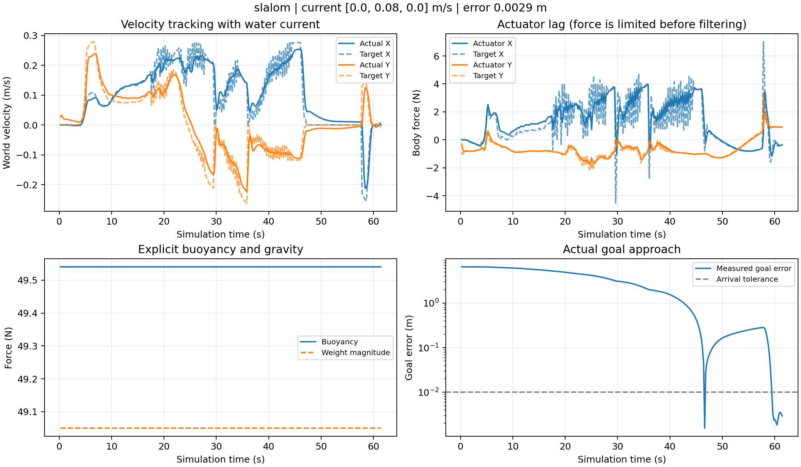

# 水动力模型与导航验证（2026-10-27）

本次将固定阻尼、中性浮力近似扩展为可配置的简化水动力模型。
实现位于 `scripts/hydrodynamics.py`，通过 `scripts/run_sim.py` 接入 PhysX。
保留 `physics_mode: legacy` 作为历史执行模型对照。

## 物理模型

- PhysX 施加真实重力 `mg`，运行时为机器人开启重力并设置质量、重心和惯量。
- 浮力为 `rho * displaced_volume * g * submerged_fraction`，沿世界 Z 正方向。
  浮心高于重心 0.025 m，浮力对重心产生横滚/俯仰恢复力矩。
- 先把世界速度减去世界水流速度，再变换到机体系。
  各轴阻力为 `-D1*v_relative - D2*abs(v_relative)*v_relative`。
- 机体系角速度对应线性及二次旋转阻力。
- 限幅后的推进力、力矩经过一阶响应；精确离散系数为 `1-exp(-dt/tau)`。
  内置 PhysX 线性/角阻尼设为零，避免重复施加流体阻力。
- 水域外或船体完全离水时不施加浮力和流体阻力。水面附近用旋转船体
  包围盒的垂直重叠比例近似浸没率，水平范围使用已有已知水域多边形。
  这是简化浸没率，不是网格精确排水体积或 CFD。
- 流体与控制状态按物理时间更新，暂停不推进；相机初始化期间暂不开启重力。

本轮沿用原实验 5 kg 质量，不冒充实机质量。默认排水量 0.00505 m³，
全浸没浮力约 49.5405 N、重量 49.05 N，为 1% 正浮力。
船体用于碰撞与水面覆盖的包围盒不等于排水体积。
参数均未通过实机辨识，没有加入附加质量、海浪、缆绳、真实推进器分配或故障。

## 控制适配

速度 PI 控制器在机体系计算误差，积分力保存在世界坐标避免随转向旋转；
带积分限幅和饱和抗积分累积，用于抵消持续水流和浮力偏差。
控制器不读取真实水流值，也不直接消除模型输出的阻力。
推进力限幅 `[12,12,15] N`，力矩限幅 `[1.5,1.5,1] N·m`，
响应时间常数分别为 0.25 s 和 0.12 s。
转向仍保留前视相机约束，水动力模式偏航速率限制为 0.25 rad/s。

加入惯性后，冻结轨迹时轻微越过参考点会反转位置反馈方向。
在参考速度大于 0.01 m/s、位置误差小于 0.1 m 的区域，保留沿参考切线至少
一半参考速度的分量，避免厘米级超调引发反复掉头；横向误差反馈仍保留。
Python 跟踪器与 C++ 执行相位判定采用相同规则。
无有效地图引导时，规划器允许重新尝试，而不被失效的朝向等待永久阻塞。

## 配置与复现

`config/experiment.json` 保存默认完整参数。覆盖文件只替换顶层键；
传入 `hydrodynamics` 对象时，其遗漏字段使用模型默认值，不和原对象递归合并。
可以使用已有单终端批量运行方式：

```bash
# 默认横流 [0,0.08,0] m/s
python3 scripts/run_suite.py --output-dir logs/suites/NEW_HYDRO_RUN
# 静水
python3 scripts/run_suite.py --scenarios slalom --overrides config/experiments/hydro_still_water.json --output-dir logs/suites/NEW_STILL_RUN
# 斜流 [0.08,0.04,0] m/s
python3 scripts/run_suite.py --scenarios slalom --overrides config/experiments/hydro_oblique_current.json --output-dir logs/suites/NEW_OBLIQUE_RUN
# 历史物理近似
python3 scripts/run_suite.py --overrides config/experiments/legacy_physics.json --output-dir logs/suites/NEW_LEGACY_RUN
```

C++ 朝向协调修改后先执行 `bash scripts/build_planner.sh`。
每次切换模型都重启导航和仿真；不需要修改外部 OceanSim、水池或 BlueROV 资产。

控制日志记录相对水流速度、阻力、浮力、实际推进力、目标推进力、力矩、浸没率
和饱和状态。`force` 包含浮力但不包含 PhysX 重力，不等于推进器力；
不能把其约 49 N 的 Z 分量解释为垂向推进力。
运行清单增加 Git 基线提交、工作区状态与完整配置；源码快照 SHA256 标识实际受测代码。
原始大日志留在本机，提交可移植汇总到 `docs/validation/`。

## 验证方法

```bash
python3 scripts/test_hydrodynamics.py
python3 scripts/test_tracking_control.py
/home/ache/isaac-sim/python.sh scripts/test_hydrodynamics_isaac.py --output logs/diagnostics/NEW_PROBES.json
```

独立物理检查覆盖阻力耗散、水流坐标、浮力/重量平衡、部分浸没、浮心恢复、
响应时间常数、限幅、积分抗饱和与横流补偿。
PhysX 探针另外验证无控制漂流、浮起、出水下落、倾斜恢复和闭环定点。
导航维持理想深度、真值定位、0.5 m XY 膨胀及小于 1 cm 连续保持 2 s 的判据。

## 迭代记录

`hydro_first_20261027` 是按渲染帧推进执行器状态的初稿，只跑 baseline，不作为最终证据。
`hydro_cross_current_20261027` 在 baseline 后中止，发现初始化重力问题。
`hydro_cross_final_20261027` 是第一次完整诊断批次：baseline、mixed 到达，
slalom 和 gates 因占用目标保持，pillars 超时；五场均无非零接触冲量。
这些失败是加入新动力条件后暴露的结果，保留日志，不以旧成功数据替代。
随后修正转向小超调、失效引导重试与转向速率，继续完整回归。

## 最终默认横流回归

数据目录 `logs/suites/hydro_iteration2_20261027`。五场使用同一核心源码与动力学参数，
起点、目标、布局、感知与到达判据保持一致，每场预算 180 s 仿真时间。

| 场景 | 仿真用时(s) | 最终误差(mm) | 最大接触冲量(N·s) |
|---|---:|---:|---:|
| baseline | 87.90 | 3.381 | 0 |
| slalom | 61.47 | 2.867 | 0 |
| gates | 62.40 | 1.519 | 0 |
| pillars | 66.83 | 0.908 | 0 |
| mixed | 82.50 | 1.202 | 0 |

末尾 2 s 保存的位置采样均在 1 cm 内；未发现 PhysX 运行错误，
推进力/力矩均在限幅内，本批没有力/力矩饱和采样。
最大采样速度 0.282 m/s，最大高度偏差 0.0186 m（含启动过渡）。
baseline 有零冲量接触报告，不能将报告次数当作实体碰撞次数。
导航保持真值定位和理想深度，slalom 仍允许外围绕行。
五场各一次通过不是统计成功率，也不能据此声称比历史版本普遍更快。
终端仍能观察到惯性超调及停车转向，后续可继续改进前馈和终端减速。

[完整配置、指标、受测源码校验值与核验](validation/hydrodynamics_20261027/five_scenarios.json)
· [第一轮失败汇总](validation/hydrodynamics_20261027/iteration1_summary.json)
· [五场实际路线与 PNG/SVG/PDF](figures/hydrodynamics_20261027/README.md)



PhysX 物理探针 9 项通过。在相同斜流与正浮力下，30 s 定点试验中，
带积分补偿的最终位置偏差约 0.0053 mm；关闭积分时偏差约 40.6 mm。
这验证了简化模型内的稳态扰动抑制，不代表真实机器人具有微米级定位能力。
[物理探针结果](validation/hydrodynamics_20261027/physx_probes.json)。

纯数值测试共 25 项（水动力 13、跟踪 9、样条 3）通过；
C++ overlay 构建、真实规划器朝向/恢复/目标替换/终端回归、执行相位时钟回归通过。
新增 GitHub Actions 自动运行纯数值测试；Isaac/ROS 集成验证仍需本机环境。

静水 slalom 独立复验：67.07 s、最终误差 5.220 mm，最大接触冲量零，
保持相同核心源码与正浮力设定，仅将水流设为零。
[静水复验核验](validation/hydrodynamics_20261027/still_water.json)。

斜流 `[0.08,0.04,0] m/s` 复验：slalom 为 112.37 s / 4.273 mm，
gates 为 80.77 s / 5.194 mm，两次均完成严格到达判据且最大接触冲量零。
斜流 slalom 明显变慢，包含停车转向和恢复过程，当前并未保证任意水流方向或强度。
[附加条件完整核验](validation/hydrodynamics_20261027/additional_conditions.json)。

旧物理模式 baseline 切回复验为 45.37 s / 2.565 mm，严格到达，最大接触冲量零。
该对照保留当前跟踪/规划修正，只恢复旧力学近似，不等于逐字节复现历史软件。
[切回复验](validation/hydrodynamics_20261027/legacy_check.json)。

最终交付核心源码与五场受测快照的 SHA256 一致。原始大日志位于本机 `logs/suites/`；
仓库保存配置、核验与未平滑位置采样，见
[实际轨迹采样](validation/hydrodynamics_20261027/measured_paths.json)。
