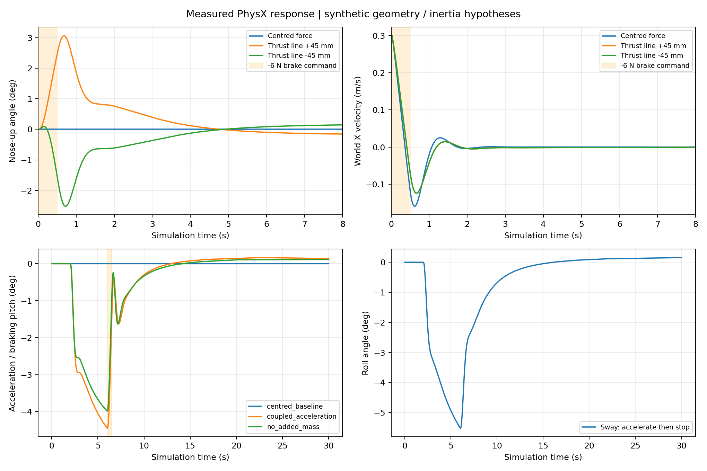
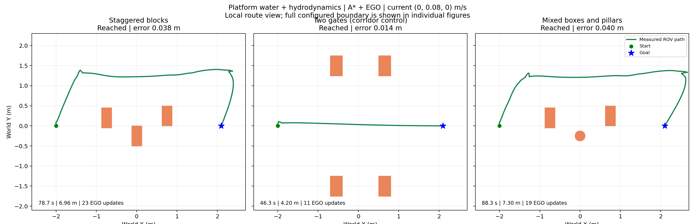
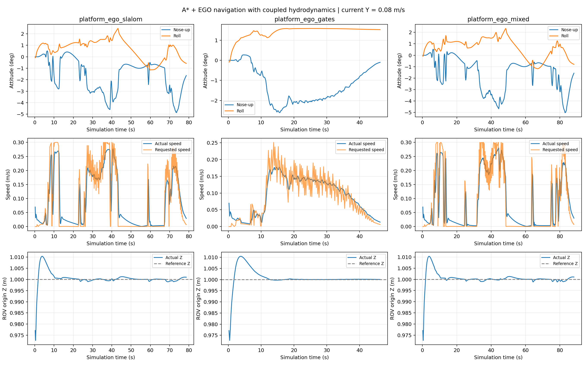

# 水动力姿态耦合迭代（2026-11-02）

初次迭代按用户要求仅保留本地；2026-11-02 用户明确授权将本轮提交到 GitHub。本次提交保存水动力代码、覆盖配置、探针与绘图脚本、验证证据及结果清理记录。既有场景、水面材质、活动场景和其他先前未提交的 demo 改动不纳入本轮提交。新版由覆盖配置显式启用，默认旧入口仍可复现原模型。

## 发现与修改

旧模型虽有浮力恢复力矩和旋转阻尼，但推进力、平移阻力集中在质心；对称水平初态下缺少激发俯仰/横滚的平移力矩。因此同条件 mixed 基线中 pitch、roll 的最大值都为 0°。

在 `scripts/hydrodynamics.py` 增加：

- 推进力作用点相对质心的偏移，附加力矩为 `r_thrust × F_actual`，采用经过执行器滞后的实际力。
- 六个船体采样点的阻力，局部相对速度为 `v_relative + omega × r`；逐点汇总力和 `r × F`。平移阻力系数按采样点数分摊，保持旧纯平移阻力标定量级。
- 对角平移附加质量、转动附加惯量和相关科氏耦合；解析求解有效质量系统后，把附加反作用力/矩交给 PhysX。没有用速度差分估计加速度，也没有把浮力或干质量重复计入。
- 启用 PhysX 刚体陀螺力矩；新增姿态、作用点力矩和附加质量反力日志。

已有的重力、浮力恢复力矩、推进器滞后、PI 速度控制、限幅及 ROS 感知规划链保留。相机继续挂在 ROV 刚体上，随真实姿态运动；没有手工设置姿态、动画或锁住 roll/pitch。

模型结构参考 Fossen 的 Marine Craft Model（六自由度质量、科氏、阻尼和恢复力项）；本实现采用 Z-up 坐标和对角近似，不能直接照搬其 NED 符号，也不是完整参数辨识模型。

## 当前待标定配置

`config/experiments/hydro_coupled.json`：

| 参数 | 值 | 含义 |
|---|---|---|
| thrust_offset_body_m | [0, 0, 0.045] m | 合力作用线位于质心上方 45 mm |
| drag_offset_body_m | [0, 0, 0.015] m | 阻力采样中心偏移 15 mm |
| distributed_drag | 1 | 启用分布式阻力 |
| added_mass_kg | [1, 2, 3] kg | 三轴附加质量假设 |
| added_inertia_kg_m2 | [0.025, 0.035, 0.04] kg m² | 三轴附加惯量假设 |

这些数值是用于检验机制的合成参数，不是测量得到的 BlueROV 几何或水动力系数。作用点均相对质心，以机体 X 向前、Z 向上定义。抬头还是低头由作用线和阻力中心共同决定，不应假定所有真实 ROV 都会急停抬头。

## PhysX 急停与消融

`scripts/probe_coupled_hydrodynamics.py` 用真实 PhysX 刚体进行八组试验，物理步长 1/120 s，运行 30 s。水平急停组初速度为 0.3 m/s，前 0.5 s 请求 -6 N 反推，仍经过执行器一阶响应，随后交回零速度控制。该固定反推脉冲是诊断激励，会短暂产生反向速度；不是生产导航急停策略。

| 条件 | 结果 |
|---|---|
| 相同急停、集中力旧模型 | 姿态保持 0° |
| 推进线高于质心 45 mm | 最大抬头 3.070° |
| 推进线低于质心 45 mm | 最大低头 2.519° |
| 侧向加速再停车 | 最大横滚绝对值 5.522° |
| 初始倾斜释放 | 恢复至接近水平 |

从静止加速再刹车时，ROV 先处于低头配平，刹车相对刹车前抬头约 4.036°，不意味着相对水平一定为正角。最初使用“必须超过水平”的判据把这一情况判失败；中间迭代日志已按清理策略删除，最终另设水平初态急停组验证正向抬头。

18 项水动力数值测试、9 项跟踪测试、3 项样条测试通过；包括耗散性、力臂符号、附加质量加速度和自由运动能量检查。PhysX 的 7 项验收检查全部通过。



## 导航复测

沿用 Platform 场景、运行时相机点云、A*、EGO 和 tracker；真值位姿、理想深度、固定深度参考 1 m。每场到达判据 5 cm 内保持 2 s。所有结果均为单次运行。

| 条件 | 到达 | 终点误差 cm | 用时 s | 最大俯仰绝对值 ° | 最大横滚绝对值 ° | EGO 更新 |
|---|---|---:|---:|---:|---:|---:|
| Slalom，新模型，0.08 m/s | 是 | 3.829 | 78.67 | 4.865 | 2.458 | 23 |
| Gates，新模型，0.08 m/s | 是 | 1.417 | 46.30 | 2.606 | 1.585 | 11 |
| Mixed，新模型，0.08 m/s | 是 | 3.993 | 88.30 | 5.015 | 2.338 | 19 |
| Mixed，集中力基线，0.08 m/s | 是 | 3.546 | 59.63 | 0.000 | 0.000 | 22 |
| Mixed，新模型，0.16 m/s | 是 | 1.251 | 77.73 | 5.143 | 4.564 | 25 |

全部运行没有接触事件或非零接触冲量，力/矩没有饱和，姿态有限，浸没比例约 1。新模型默认流速三场最大深度参考误差约 2.733 cm。强流测试最大倾斜约 5.766°。

以实际姿态修正船体中心，用外接球对新增障碍包围盒估计的保守净空分别为 Slalom 0.354 m、Gates 0.803 m、Mixed 0.340 m；强流 Mixed 为 0.195 m。原扫描网格的采样球净空三场均至少约 0.139 m；强流约 0.139 m。采样船体八角均位于配置水域内。检查间隔约 0.2 s，不是连续扫掠安全证明。

新模型 mixed 单次比基线慢，不能宣称效率提升。强流路线和重规划时序不同，也不能把更短用时解释为强流更容易。默认 mixed 仍出现转向等待，是后续控制和规划协同的改进项。




## 自己在 GUI 验证

关闭旧仿真和导航进程，分别在三个终端执行以下公共设置：

```bash
cd /home/ache/Coding/rov_navigation
export ROS_DOMAIN_ID=119
export ROV_SCENARIO=platform_ego_mixed
export ROV_EXPERIMENT_OVERRIDES="$PWD/config/experiments/hydro_coupled.json"
```

终端一启动仿真，等待 `ROV ready`：

```bash
bash scripts/start_sim.sh --scenario platform_ego_mixed \
  --scene-file scenes/pool_platform_ego_mixed.usda --view perspective
```

终端二：

```bash
bash scripts/start_navigation.sh
```

终端三：

```bash
bash scripts/send_goal.sh --goal 2.1 0.0
```

无需重新 build USD，本轮没有修改水面材质。选择侧面/斜侧面观察 ROV，俯视图不容易看到几度的俯仰。三场景切换时三个终端都改为对应场景，并重启清除旧地图。强流使用 `hydro_coupled_current016.json`，集中力对照使用 `hydro_centered_reference.json`，每次切换覆盖配置后必须重新启动。不设置覆盖变量时新耦合项仍为零，不能期待看到新版效果。

原始诊断数据在 `logs/hydro_coupled_20261102/`；导航数据在 `logs/suites/platform_coupled_20261102/`、`platform_centered_20261102/` 和 `platform_coupled_current016_20261102/`。可审阅证据在 `docs/validation/hydrodynamics_coupled_20261102/`，图像在 `docs/figures/platform_coupled_20261102/`。manifest 保留每次试验的未提交状态、源码快照与 SHA256；旧提交号不是本次未提交代码的唯一标识。

复测命令：

```bash
python3 scripts/run_suite.py \
  --scenarios platform_ego_slalom platform_ego_gates platform_ego_mixed \
  --overrides config/experiments/hydro_coupled.json \
  --output-dir logs/suites/NEW_COUPLED_REVIEW --domain 119 \
  --sim-time-limit 150 --wall-time-limit 550 --arrival-tolerance .05 --settle-time 2
/home/ache/isaac-sim/python.sh -u scripts/probe_coupled_hydrodynamics.py \
  --output logs/NEW_COUPLED_PROBE.json
```

## 适用范围与下一步

目前是带三维姿态扰动的固定深度导航，尚未升级成全三维规划。没有真实推进器安装位置/方向和推力分配器、时空变化水流、波浪、缆绳、涡流或完整附加质量矩阵。近自由液面时的附加质量随浸没比例缩放只是近似，当前试验均完全浸没。没有验证退化深度或真实定位误差。

下一步应测量推进线、重心/浮心和阻力中心，并用加速、滑行、急停实验辨识系数，再检验不同初始姿态、转向和多次重复运行。当前成果是补上原模型缺失的物理机制并给出可检验响应，不能据此声称已还原真实 ROV 的姿态幅值。后续模型升级仍先本地验证，再由用户明确授权提交。

## 当前几何模型与本次提交边界

当前水动力按包围尺寸构造六个采样点，未读取可视 ROV 网格的面法线、迎流面积或部件外形。三轴线性/二次阻力系数、对角附加质量、惯量与作用点偏移为输入参数。碰撞体仍为既有长方体。因此本轮不是按真实外形求解的流体模拟，部件级阻力、真实推进器分配和 CFD 均未实现。

已有停车日志表明：Mixed 在 t=13.633 s 请求水平速度为零时，实际水平速度约 0.242 m/s；0.2 s 后约 0.144 m/s，0.6 s 后约 0.013 m/s。该响应含主动反推制动，不是撤推自由滑行。偏航有惯量与力矩滞后，但独立的偏航启停验收尚未完成，不能把现有探针解释为已验证所有转向特征。

本轮提交同时收录用户授权的结果清理：保留各阶段最终完整批次与必要对照，删除中间运行、重复探针和六份完全重复的图片 ZIP；最终录像和实测数据保留。各阶段入口见 [结果索引](results_index.md)，逐文件清单见 [清理记录](validation/results_cleanup_20261102.json)。logs 被 Git 忽略，本机删除不意味着旧 Git 历史同步删除。
