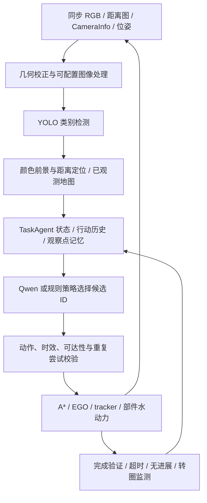

# 水下视觉前端与持续任务 Agent：2026-11-16

## 对老师建议的理解与现状审计

老师可能希望系统围绕任务持续感知、执行、评估和调整，而不是每次只根据当前一帧向模型询问动作。无法替老师确认具体意图，但这一理解与提供的[优化建议](references/ROV_Agent_Driven_Optimization_Plan.md)一致。该文档作为设计输入，不作为现有功能的证据。

现有代码已经有异步 Qwen/DeepSeek JSON 决策、扫描/探索/接近/确认状态机、已观测地图、短时目标记忆、失败位置排除、有限局部恢复与动作校验，因此无需重新搭建框架。此次补足了可记录的行动结果和跨轮任务记忆，并把它们交给现有决策接口。



任务层 `SEARCH / VERIFY / APPROACH / RECOVERY / DONE / FAILED` 与原有执行状态并存。`VERIFY` 同时覆盖疑似目标观察和到达后的视觉确认；暂未引入独立多视角几何验证器。当前任务仍为单目标寻找与接近，没有实现任意巡检、多目标序列或操作物体。

## 三篇原文及采用方式

原文访问地址及 PDF 校验值见 [文献来源](references/underwater_vision_sources_20261116.json)，PDF 不复制进项目。

1. **Shortis (2015), Calibration Techniques for Accurate Measurements by Underwater Camera Systems**：阅读标定模型、折射处理及验证部分。水下相机需要考虑水和舱窗折射，空气标定不能直接代表水下标定；标定后的重投影误差也不能替代独立长度精度验证。当前采用 OpenCV 中心投影的经验畸变模型，并提供实际水下棋盘格标定入口。该模型可在适用范围内近似吸收部分折射效应，但并非显式平面舱窗非中心折射模型。
2. **Ancuti et al. (2018), Color Balance and Fusion for Underwater Image Enhancement**, DOI `10.1109/TIP.2017.2759252`：阅读红通道补偿式 (4)、灰世界白平衡、归一化非锐化掩蔽式 (6)、Laplacian/显著性/饱和度权重与多尺度融合。实现了对应的轻量分支，增益限幅、金字塔层数和滤波参数采用工程配置，未宣称逐像素复现作者结果。CLAHE 是额外比较基线，不是该论文的核心算法。
3. **Akkaynak & Treibitz (CVPR 2019), Sea-thru: A Method for Removing Water From Underwater Images**：阅读式 (2)、后向散射估计和距离相关衰减估计。论文利用 RGB-D、暗像素和距离分层估计散射，并用局部照明估计距离相关衰减。当前 `range_restore` 仅采用分离直接衰减与后向散射的成像公式，以已知 OceanSim 参数做有界逆变换；未实现完整 Sea-thru 的逐图参数估计，不能称作完整 Sea-thru。

原建议文档第 6 节提到的 2018 Revised Underwater Image Formation Model 是另一篇论文；本次以用户明确列出的 Color Balance and Fusion 为第二篇。

## 视觉实现与限制

- `scripts/semantic_vision.py`：`none / white_balance / clahe / wb_clahe / fusion / range_restore`，通过 `--vision-config` 选择。
- `config/semantic/vision.json`：默认 `none`；依据固定检测器的对照结果，未将增强强制替换为识别默认输入。
- 非零 CameraInfo 畸变时，同步校正 RGB 和距离图，保留对应 K；距离图使用最近邻重采样，避免把前景、背景距离平均；边界置无效距离。距离值为沿射线的米制 range，不是光轴 Z。
- 默认 `color_source=raw`：YOLO 可使用增强图，颜色/定位仍使用几何校正后的原始颜色和既有颜色模型，避免增强改变模型训练分布。实验性 `processed_hsv` 使用处理后 HSV 规则；此模式尚未作为生产推荐。
- `latest_sensor.npz` 保存 `rgb`（检测输入）、`raw_rgb`（原始曝光）、`rectified_raw_rgb`（几何对齐后原色）、距离和 K。调试窗口明确显示“检测输入”，日志记录方法与耗时。
- OceanSim 当前发布零畸变 CameraInfo；没有读取到非零畸变时不额外扭曲画面。当前仿真并未验证真实舱窗折射。
- `range_restore` 默认参数与本机 OceanSim **实际赋值代码**对应：直接衰减 `[.05,.05,.05]`、散射系数 `[.05,.05,.2]`、背景光 `[0,.31,.24]`。本机 `UW_Camera.initialize` 的文档说明与默认数组索引赋值顺序存在差异，以实际渲染调用为准。换水质或相机必须重新确认；当前逆变换与渲染器的 LDR 数值域一致，不代表真实相机线性辐射定标。

### 实际相机标定入口

至少准备 12 张检测到棋盘格的水下照片，固定分辨率、焦距和舱窗，覆盖不同距离、倾角及画面边缘：

```bash
python3 scripts/calibrate_underwater_camera.py /path/to/underwater_checkerboards \
  --cols 9 --rows 6 --square-m 0.025 \
  --output logs/camera_calibration/report.json \
  --vision-output config/semantic/vision_profiles/my_camera.json
```

这里 cols/rows 是内角点数。脚本将部分视图留作重投影检查，并导出可传给 `--vision-config` 的参数；未提供真实棋盘格数据，因此尚未产生本项目实测水下标定。应另用已知长度和不同距离的验证物体检验三维定位精度。RGB 和 range 必须原本使用相同光学模型且像素对齐，不应把不对齐的另一相机深度直接套用此接口。

## Agent 实现

配置 `config/semantic/agent.json` 默认启用任务层；`--agent-config config/semantic/agent_profiles/disabled.json` 可进行基线对照。

- 每个动作记录开始时刻、候选 ID、来源观测 ID，结束后输出 `SUCCEEDED / FAILED / TIMEOUT / ABORTED` 及原因。完整结果写入 `agent_tool_result` 事件，最后保存 `agent_memory.json`。
- 最近 12 次行动结果、观察点尝试/失败/到达记录进入后续真实 API 请求，不需要向量数据库。
- 搜索区域是世界坐标 `xmin,ymin,xmax,ymax` 的**软先验**；先在已观测可通行空间生成可达候选，再结合区域接近程度和访问惩罚排序。未知区域不会因此变成可通行。
- `west_search.json` 提供宽范围 `[-6,-2,-3,2.5]`，运行时不读取目标真值；当前范围由配置明确给定，尚未将任意自然语言方位自动转换成坐标区域。
- 同一观察点尝试次数限制、失败冷却、连续 hold 上限均可配置；异步返回动作执行前再次校验。
- 导航阶段在 20 s 窗口内最大离开起点距离不足 0.15 m、累计绝对转角超过 240° 时，保持位置、记录失败并排除当前失败位置，随后重新决策。主动扫描/恢复阶段不使用此检测；旧的无进展和动作超时保护仍保留。阈值为工程初值，不能保证消除所有局部规划异常。
- 任务成功仍由目标身份、时效、距离、朝向和低速保持共同确认；LLM 的 report 只能报告失败/搜索耗尽，不能宣告成功。

## 视觉对照结果

[72 张测试图像量化结果](validation/vision_agent_20261116/vision_test/metrics.csv)，固定同一个已训练 YOLO，置信度 0.45，按类别 IoU≥0.5 一对一匹配；不是 mAP。数据有 193 个可见标注目标。

| 方法 | 正确匹配 | 误检 | 漏检 | Precision | Recall |
|---|---:|---:|---:|---:|---:|
| 原图 | 178 | 3 | 15 | 98.34% | 92.23% |
| 白平衡 | 174 | 11 | 19 | 94.05% | 90.16% |
| CLAHE | 174 | 6 | 19 | 96.67% | 90.16% |
| 白平衡+CLAHE | 171 | 13 | 22 | 92.93% | 88.60% |
| 融合 | 173 | 11 | 20 | 94.02% | 89.64% |

该检测器在原始 OceanSim 风格图像上训练，当前结果不支持直接替换其输入分布。测试集仅作诊断，未用它训练或调参。后续需要独立验证集、增强一致的数据训练和不同水质测试。

[图像方法对比](validation/vision_agent_20261116/vision_test/comparison.png)；[带距离合成色卡](validation/vision_agent_20261116/rgbd/synthetic_range_chart.png)。在生成和恢复参数相同的理想合成色卡上，range_restore 将 RGB 平均绝对误差从 14.14 降至 1.14（0–255）。这仅验证公式和实现；没有测得真实相机颜色准确率，既有检测测试集也没有逐物体颜色标签，不能虚构颜色分类指标。

[真实保存 RGB-D 蓝管对照](validation/vision_agent_20261116/rgbd/blue_pipe_rgbd_comparison.png)、[黄箱对照](validation/vision_agent_20261116/rgbd/yellow_box_rgbd_comparison.png)、[红箱对照](validation/vision_agent_20261116/rgbd/red_box_rgbd_comparison.png)为离线重新推理；相邻 JSON 保留原色模型与增强 HSV 的输出供检查。

## 启动与调参

```bash
cd /home/ache/Coding/rov_navigation
python3 scripts/run_semantic_trial.py --gui --policy qwen --env-file .env.semantic \
  --instruction '在水池西侧区域寻找黄色方块，靠近它并保持一米。' \
  --scene-file scenes/pool_platform_semantic_yellow_box_turn.usda \
  --agent-config config/semantic/agent_profiles/west_search.json \
  --output "logs/agent_yellow_$(date +%Y%m%d_%H%M%S)" --domain 176
```

对照图像处理时添加 `--vision-config config/semantic/vision_profiles/clahe.json`。其它方法对应同目录文件。粗略区域通过 agent 配置修改；检测和颜色路径通过 vision 配置修改；每次启动把有效参数冻结到运行目录 `config/agent.json` 和 `config/vision.json`。

离线评估无需启动 Isaac 或调用 API：

```bash
python3 scripts/evaluate_underwater_vision.py --output logs/vision_benchmark
python3 scripts/evaluate_underwater_rgbd.py --output logs/vision_rgbd_comparison
```

依赖沿用项目语义 Python 环境；若系统缺少 ONNX Runtime，可使用 `PYTHONPATH="$PWD/.venv/semantic_ros:$PWD/scripts"`。

## 尚未完成的能力

真实相机折射标定、完整 Sea-thru 参数估计、图像增强一致的检测器重训练、多水质重复统计、独立 INSPECT 工具和多目标长期任务仍需后续工作。本次没有将已有红箱碰撞问题判为已解决，也没有依据单次运行宣称 Agent 优于旧策略。实现与证据留在工作区，待用户验证后再按指令提交。


## 本次实际运行与验收

[完整验证索引](validation/vision_agent_20261116/README.md)。本次真实 Qwen+Isaac Sim 运行：

| 配置 | 仿真耗时 | 航程 | 接触报告 | 离线审核 |
|---|---:|---:|---|---|
| 旧接口基线，原图，无区域加权 | 64.4 s | 1.983 m | 无 | 通过 |
| Agent 初版，原图，区域提示 | 65.5 s | 2.103 m | 无 | 通过 |
| Agent 初版，CLAHE，区域提示 | 67.1 s | 2.123 m | 无 | 通过 |
| 最终 Agent，原图，区域提示 | 66.0 s | 2.096 m | 无 | 通过 |

均为同一黄箱任务、四次运行，每次四个高层决策。最终版实际过程：2.1 s 扫描，17.4 s 记录扫描成功，19.9 s 探索，33.6 s 记录到达，36.1 s 再扫描，49.3 s 确认发现目标，52.5 s 接近，66.3 s 输出停靠确认成功。耗时统计减去任务起始时刻，所以与事件时间相差约 0.3 s。

第二次及之后的真实 API 请求包含前一动作结果，见 [逐轮反馈](validation/vision_agent_20261116/qwen_yellow_final/agent_trace.md)。这证明反馈进入连续决策接口，不足以证明模型内部推理一定使用了某条记忆。最终水平表面距离约 1.174 m，在既有完成容差内，并非精确停在 1.000 m。

这次 Agent 没有比基线更快；比较中同时改变了任务记忆和区域先验，不能归因到其中一个因素。图像增强也没有表现出检测或导航优势，故默认保持原始识别输入。所有运行未触发转圈保护；测试验证其会在导航转圈时保持位置、记录失败、排除该位置，并排除主动扫描。

100 项相关测试通过，包括合成棋盘格标定恢复及留出视图检查、畸变射线/图深对齐、距离恢复、任务反馈、重复动作预算、真实状态机转圈处理和既有配置/导航测试。合成标定测试不等于完成真实水下相机标定。CLI 配置检查与 Python 语法检查通过。

## 同日后续：偏黄问题修正

新增同帧参考验证、`range_preserve` 保色预览与明确灰卡标定接口，见 [第二次视觉迭代](vision_color_preservation_20261116.md)。推荐的新 profile 使用原图检测、处理图预览两条路径；请勿将预览图当成实际 YOLO 输入。旧图像对比保留为第一次实验记录。
